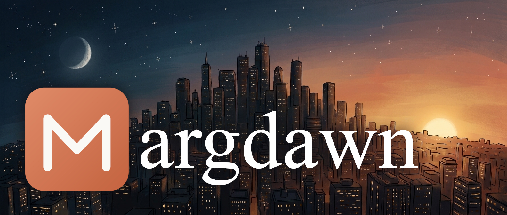

# margdawn

A minimal, fast Markdown viewer in Rust — one codebase, two frontends:

| Binary         | What it is                                                                 |
| :------------- | :------------------------------------------------------------------------- |
| `margdawn`     | terminal viewer, renders styled markdown with ANSI colors                  |
| `margdawn-gui` | desktop viewer, registers itself as an "Open with…" option for `.md` files |

_Viewer only_ — margdawn never edits your files. (Contributions welcome.)

## Install

For the user's target platform.

### Fedora (.rpm)

```bash
cargo install cargo-generate-rpm
cargo build --release
cargo generate-rpm -p crates/margdawn-gui
sudo dnf install target/generate-rpm/margdawn-gui-*.rpm
```

Or `make rpm` then `sudo dnf install target/generate-rpm/margdawn-gui-*.rpm`.

That installs both `margdawn` and `margdawn-gui` to /usr/bin, plus the desktop
entry + icon so `.md` files show "Margdawn" when you right-click them in
Dolphin (`Open With` → `Margdawn`, or set as default).

### Debian/Ubuntu (.deb)

```bash
sudo apt install cargo
cargo build --release
cargo deb -p margdawn-gui   # requires: cargo install cargo-deb
sudo dpkg -i target/debian/*.deb
```

### Any platform (from source)

```bash
cargo build --release
# binaries land in target/release/{margdawn,margdawn-gui}
```

Or install just the CLI tools:

```bash
cargo install --path crates/margdawn-cli
```

### Other systems

- **Windows**: `cargo build --release` — `.config` maps to `%APPDATA%\margdawn`.
- **macOS**: as above; config lives in `~/Library/Application Support/margdawn`.

## Usage

```bash
margdawn README.md              # view in terminal
margdawn --theme nord file.md   # one-off theme override
margdawn-gui file.md            # view in GUI
```

GUI extras: `Ctrl+O` opens a file, drag & drop works, Reload button re-reads.

## Themes

Themes live in `~/.config/margdawn/themes/<name>/theme.json`; the active theme
is set in `~/.config/margdawn/config.json`:

```json
{
  "theme": "claude",
  "code_theme": "monokai",
  "font_size": 15,
  "line_height": 1.5,
  "paragraph_spacing": 8,
  "margin": 28,
  "preserve_blank_lines": true,
  "font_body": "sans",
  "font_heading": "serif",
  "font_mono": "jetbrainsmono",
  "background": false,
  "code_background": false
}
```

(All fields optional; missing/broken values fall back to defaults.)

### GUI settings panel

The Settings button (top bar) exposes everything live: app theme, code
theme, font size, line height, paragraph spacing, page margin, body/heading/
code faces, blank-line handling — plus a **theme editor** with color pickers
for every palette slot that can save new personal themes. Changes apply
instantly and persist to config.json.

Quick CLI shortcuts:

```bash
margdawn --list-themes              # user + built-in themes
margdawn --set-theme claude         # write config.json
```

Built-in themes: **`claude`** (default — claude.com's dark palette:
`#141413` background, clay accent, serif headings), `claude-light` (the ivory
light palette) and `monokai-night`. Code blocks default to a separate
`monokai` syntax theme regardless of the app theme.

claude.com uses proprietary Anthropic Sans/Serif/Mono fonts, which cannot be
redistributed; margdawn bundles the closest open equivalents instead:
**Inter** (sans), **Source Serif 4** (serif) and **JetBrains Mono**. Headings
use the theme's serif face and body text its sans face, like claude.com.

### Custom themes

Copy an existing one or start fresh:

```bash
mkdir -p ~/.config/margdawn/themes/my-theme
cat > ~/.config/margdawn/themes/my-theme/theme.json <<'EOF'
{
  "name": "my-theme",
  "appearance": "dark",
  "colors": {
    "background": "#1E1E1E",
    "foreground": "#D4D4D4",
    "heading": "#569CD6",
    "link": "#3794FF",
    "code": "#CE9178",
    "code_background": "#252526",
    "quote": "#6A9955",
    "quote_bar": "#569CD6",
    "list_marker": "#4EC9B0"
  }
}
EOF
```

Any omitted slot falls back sensibly, so partial themes work. Appearance is
inferred from the background if not given.

### Importing themes from other apps

Code-block themes are syntect `.tmTheme` files; defaults ship in-app and
extra ones import with:

```bash
margdawn --import-code-theme ~/Downloads/MonokaiClassic.tmTheme
```

margdawn reads **VS Code color theme files** (`*.color-theme.json` from the
marketplace / theme generators) — the de facto standard JSON color scheme
format that many other editors use:

```bash
margdawn --import-theme ~/Downloads/SomeTheme-color-theme.json
# or with a custom name:
margdawn --import-theme ~/Downloads/SomeTheme-color-theme.json myname
```

Headings/links/code colors are mapped from the theme's `tokenColors` scopes.

## Config fallback behaviour

Bad config.json, missing/invalid theme file, unknown keys — margdawn falls
back to the built-in default (`monokai-night`) with a warning instead of
failing:

```
warning: theme `nord` from config.json could not be used (...); falling back to `monokai-night`
```

## Notes

- Terminal mode picks colors based on terminal support: truecolor when
  available, otherwise ANSI-256; output piped into a non-TTY renders plain
  text.
- Footnotes, tables, task lists, fenced and indented code are supported.
  Code blocks are syntax highlighted (syntect) in both frontends. GUI tables
  use natural column widths with borders and scroll horizontally when wider
  than the window; terminal tables are boxed and shrink to fit.
- The author's blank lines between blocks are preserved as vertical space in
  the GUI (toggleable). The terminal renderer always uses a single blank line
  between blocks for a consistent rhythm, like agent CLIs.
- Terminal output is laid out like glamour/agent CLIs: a 2-column document
  margin with two blank lines of margin above and below the document, greedy
  word wrapping with hanging indents for lists, quotes and footnotes, boxed
  tables, and optional background panels (code panels keep equal left/right
  margins). `--ascii` (or
  piping) renders the same layout without ANSI styling.
- Terminal backgrounds are **off by default**, so margdawn blends with your
  terminal's own background: only foreground colors are emitted. Two config
  keys opt in (both `false` by default and terminal-only; the GUI ignores
  them):
  - `"background": true` — paint the theme's page background across the
    terminal width.
  - `"code_background": true` — paint code-block panels and inline-code chips
    (works with or without the document background).
- **Color emoji** render inline in the GUI: Noto Emoji PNGs (Apache-2.0) are
  bundled, with Twemoji (CC-BY 4.0) covering national flags, which Noto does
  not ship. Emoji in the terminal use your terminal font.
- HTML blocks and LaTeX math are intentionally ignored (minimal!).

## Development

```
crates/
  margdawn-core    markdown parser (pulldown-cmark), theming, config, vscode importer
  margdawn-cli     binary: margdawn (ANSI renderer)
  margdawn-gui     binary: margdawn-gui (egui renderer + desktop integration assets)
```

```bash
cargo test --workspace    # 47 tests
```

> Fedora note: if your editor's rust-analyzer reports bogus errors
> (e.g. "cannot apply `!` to `bool`") while `cargo build` is clean, it is
> missing the std sources it analyzes: `sudo dnf install rust-src`, then
> restart the rust-analyzer server.

Bundled asset licenses: Inter and Source Serif 4 and JetBrains Mono (OFL),
Noto Emoji images (Apache-2.0), Twemoji flags (CC-BY 4.0); see
`crates/margdawn-gui/assets/`.
